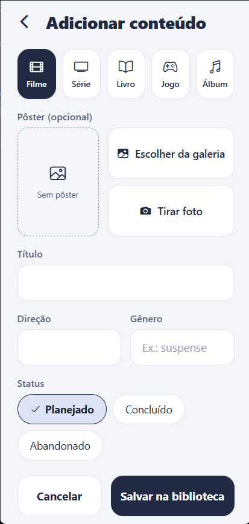
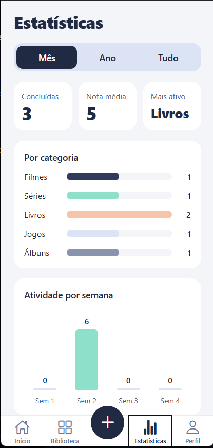

# Memora

**Your story, in every discovery.**

<p align="left">
  
</p>

**Memora** is a mobile app built with React Native that brings the record of your cultural and entertainment experiences into a single place. It lets users organize movies, TV series, books, games, and music albums in a personal library, keeping track of ratings, opinions, progress, and activity history.

More than a catalog, Memora turns everyday records into a personal archive of cultural experiences, making it easy to follow your habits and revisit past discoveries over time.

> Academic project developed for the course **CCP150 – Mobile Application Development**, as part of the Computer Science program.

> **Note:** the app's interface is written in Portuguese. Screen names are given in English in this document, with the original Portuguese name in parentheses where it first appears.

---

## Table of Contents

- [1. Overview and Requirements](#1-overview-and-requirements)
- [2. Technologies Used](#2-technologies-used)
  - [2.1. Artificial Intelligence as a Support Tool](#21-artificial-intelligence-as-a-support-tool)
- [3. Design Prototype](#3-design-prototype)
- [4. Features](#4-features)
  - [4.1. User Authentication](#41-user-authentication)
  - [4.2. Home Screen](#42-home-screen)
  - [4.3. Cultural Library](#43-cultural-library)
  - [4.4. Managing Entries](#44-managing-entries)
  - [4.5. Custom Images](#45-custom-images)
  - [4.6. Progress and Cultural Diary](#46-progress-and-cultural-diary)
  - [4.7. Statistics](#47-statistics)
  - [4.8. User Profile](#48-user-profile)
  - [4.9. Haptic Feedback](#49-haptic-feedback)
- [5. Navigation and App Structure](#5-navigation-and-app-structure)
- [6. Demo](#6-demo)
- [7. Installation and Running](#7-installation-and-running)
- [8. Learnings and Next Steps](#8-learnings-and-next-steps)
- [9. Author](#9-author)

---

## 1. Overview and Requirements

### Motivation

People who enjoy several kinds of entertainment tend to scatter their ratings and notes across different apps, or simply forget what they watched, read, or played and what they thought of it. Memora was born from the idea of bringing everything together in one place, focusing on the user's personal experience with each work rather than on a catalog of titles.

### Goals

- Bring different entertainment categories together in a personal library.
- Track the progress of each work.
- Record ratings and opinions about cultural experiences.
- Organize the user's activity history.
- Present statistics based on the records the user has made.
- Offer a personalized experience through images and information added by the user.

### Course Requirements

| Requirement | How Memora meets it |
|---|---|
| Mobile interface with React Native | 7 functional screens, besides Login and Sign Up: Home, Library, Add/Edit, Details, Statistics, Diary, and Profile. |
| Navigation with React Navigation | A root Stack Navigator combined with a five-tab Bottom Tab Navigator. |
| Database persistence | Firebase Realtime Database, with entries organized per user. |
| CRUD operations | Create, read, update, and delete entries. |
| User authentication | Firebase Authentication with email and password. |
| Native device features | Camera, image gallery, and haptic feedback. |
| Images and clear interface feedback | User-chosen covers, validation, confirmation alerts, empty states, and vibration. |

---

## 2. Technologies Used

| Category | Technology | Purpose |
|---|---|---|
| Language | JavaScript | Programming language used in the project. |
| Framework | React Native | Building the mobile interfaces. |
| Backend | Firebase Authentication (v8.10.1) | User sign-up and authentication. |
| Backend | Firebase Realtime Database (v8.10.1) | Data storage and synchronization. |
| Tools | Expo Snack and Expo Go | Developing and testing the app on a phone. |
| Tools | Figma | Prototype and visual identity. |
| Tools | Git and GitHub | Version control and code hosting. |

### Data and Image Storage

The project uses Firebase Realtime Database to store the entries and the data related to each user.

Custom images follow a different strategy: they are copied and stored locally on the device, while the database keeps only the name of the corresponding file. This approach lets users use their own covers and images without depending on external image storage services.

### 2.1. Artificial Intelligence as a Support Tool

Artificial Intelligence was used as a complementary tool during the development of Memora, helping both with the visual construction and with the implementation of more technically complex features.

It was used mainly for the following activities:

- **Visual development:** support in structuring the interfaces, organizing components, defining layouts, and improving the user experience.
- **Feature implementation:** help in designing and implementing more complex logic, especially the system for selecting, handling, and locally storing images from the device's camera and gallery.
- **Problem solving:** support in identifying errors, understanding libraries, and investigating unexpected behavior during development.
- **Code optimization:** suggestions for improving organization, component reuse, and the structure of features.

AI was used as a technical support and learning resource, helping to speed up development and to understand concepts and implementations. Integrating, adapting, validating, and applying the solutions within the app was part of the development process of the project itself.

---

## 3. Design Prototype

Before the app was implemented, an interface prototype was created in **Figma** to establish Memora's visual identity and to guide the construction of the screens.

The prototype served as a reference for the organization of visual elements, information hierarchy, navigation, and user experience.

### Visual Identity

The visual direction is clean, minimalist, and contemporary, aiming for a balance between organization and personality.

Its main characteristics include:

- Light backgrounds and well-distributed spacing.
- Deep blue as the interface's primary color.
- Soft lavender and mint-green tones for surfaces and highlights.
- Cards with rounded corners.
- Consistent typographic hierarchy and visual components.
- Work covers as highlighted elements.

### Accessing the Prototype

<ins>**[View the Memora prototype on Figma](https://www.figma.com/design/bXRqMEJh4g7fACbINFMWgN/MEMORA?node-id=0-1&t=3sTla1ObIjCIuj3f-1)**</ins>

The prototype can be used as a reference to understand the app's visual concept and the design decisions made during development.

---

## 4. Features

### 4.1. User Authentication

The app has an authentication system integrated with Firebase Authentication.

- Account creation with email and password.
- Password confirmation during sign-up.
- Login for registered users.
- Credential validation and error handling with clear messages (email already in use, weak password, invalid email, among others).
- Sign-out through the "log out" option, with confirmation.

Each user has their own library, with all records linked to their Firebase identifier.

### 4.2. Home Screen

The home screen (*Início*) gives a summary of the user's recent activity.

- Monthly summary: number of works completed and the most active category.
- Shortcut to add a new entry.
- "Log progress" shortcut, which lists the works currently in progress and opens the edit screen for the chosen one.
- Recent activity, showing the latest works added or updated.
- A button to add the first entry when the library is still empty.

### 4.3. Cultural Library

The library (*Biblioteca*) brings different entertainment categories together in a single place.

The available categories are:

| Category | Category-specific information |
|---|---|
| Movies | Director, genre, and rating. |
| TV Series | Genre, season, number of episodes, and rating. |
| Books | Author, genre, pages read, total pages, and rating. |
| Games | Platform, hours played, and rating. |
| Albums | Artist, genre, and rating. |

The library also offers:

- A grid view of all registered works, from newest to oldest.
- Search by title.
- Filters by category.
- Filters by status.
- Visual indicators of each work's status and rating.
- Access to a work's details by tapping its card.

### 4.4. Managing Entries

Memora lets users manage their personal records through CRUD operations.

- **Create:** add new works to the library.
- **Read:** view the information and details of each work.
- **Update:** edit existing records.
- **Delete:** remove works from the library, with confirmation.

Each work can have one of the following statuses:

- Planned.
- In progress (not available for movies).
- Completed.
- Abandoned.

The form adapts the fields it displays to the selected category, avoiding unnecessary information. The same screen is used both to add and to edit a work.

Users can also add a personal opinion and give a rating from 0 to 5. When a work is marked as completed, the completion date is recorded automatically.

The form validates the data before saving: the title is required and the rating must be between 0 and 5.

### 4.5. Custom Images

The app lets users personalize their records with images of their own choosing.

- Pick images directly from the gallery.
- Take photos with the device's camera.
- Crop the image to a portrait format (3:4).
- Preview the image before saving.
- Store images locally on the device.

Images are linked to their records through their file names. When a work has no image, or the file is no longer available, the app shows the category icon instead.

### 4.6. Progress and Cultural Diary

Memora lets users follow the evolution of their cultural experiences and browse a chronologically organized history.

**Progress tracking:**

- Books: pages read and total pages.
- TV series: season and number of episodes.
- Games: hours played.
- Movies and albums: status and ratings.

**Cultural diary:**

- Works displayed on a timeline.
- Records grouped by day (today, yesterday, or the date).
- Identification of completed works and updates.
- Progress information on each entry.
- Access to the opinions the user has recorded.

### 4.7. Statistics

The statistics screen (*Estatísticas*) shows information calculated automatically from the user's records.

Users can switch between three analysis periods:

- **Month:** data for the current month.
- **Year:** data for the current year.
- **All:** the complete history.

The available information includes:

- Number of completed works.
- Average rating.
- Most active category in the period.
- Distribution of works by category.
- An activity chart by week, month, or year, depending on the selected period.

### 4.8. User Profile

The profile screen (*Perfil*) presents a summary of the user's cultural journey.

- Identification based on the registered email.
- Account creation date.
- Total number of works in the library.
- Number of completed works.
- Overall average rating.
- Distribution of records by category.
- Direct access to the cultural diary.
- Option to end the session.

### 4.9. Haptic Feedback

The app uses the Expo Haptics library to provide tactile responses during important interactions, offering a subtle physical cue that complements the interface's visual feedback.

Haptic feedback is triggered in three situations:

- After saving a work.
- After deleting a work.
- After signing out.

---

## 5. Navigation and App Structure

Navigation was built with React Navigation, combining a Stack Navigator and a Bottom Tab Navigator. The login, sign-up, add/edit, details, and diary screens live in the Stack and open on top of the tabs.

### Main Navigation

The tab bar provides five options:

| Screen | Responsibility |
|---|---|
| Home (*Início*) | Monthly summary, recent activity, and shortcuts. |
| Library (*Biblioteca*) | Browsing, searching, and filtering works. |
| Add (*Adicionar*) | Adding new works. |
| Statistics (*Estatísticas*) | Indicators and charts. |
| Profile (*Perfil*) | Account information and a summary of the user's cultural journey. |

### Additional Screens

Besides the main screens, the app includes:

- Login.
- Sign Up (*Cadastro*).
- Add and edit content.
- Work details.
- Cultural diary (*Diário*).

### Data Model

Each user has their own tree in Firebase Realtime Database, identified by their `uid`. Each work is a node with an identifier generated by Firebase:

```text
/usuarios
  /{user uid}
    /obras
      /{work id}
        titulo, categoria, status, nota, opiniao
        imageName, criadaEm, atualizadaEm, concluidaEm
        + category fields (direcao, autor, paginasLidas, horas...)
```

The configuration of each category (form fields, icon, color, and allowed statuses) is centralized in `components/Obras.js`, and the screens adapt to it.

### File Organization

```text
MEMORA/
│
├── App.js
├── index.js
├── app.json
├── package.json
│
├── assets/
│   └── Logo.png
│
├── components/
│   ├── Auth.js
│   ├── Cores.js
│   ├── Formulario.js
│   ├── Haptico.js
│   ├── Imagens.js
│   └── Obras.js
│
├── config/
│   └── config.js
│
├── screenshots/
│
└── screens/
    ├── AdicionarConteudo.js
    ├── Biblioteca.js
    ├── Cadastro.js
    ├── DetalhesObra.js
    ├── Diario.js
    ├── Estatisticas.js
    ├── HomeScreen.js
    ├── Login.js
    └── Perfil.js
```

This structure separates screens, reusable components, configuration, and shared functions, which makes the code easier to maintain and organize.

---

## 6. Demo

### Video

**[Watch the Memora demo](https://youtube.com/shorts/NVnXMFQTy98)**

The video shows the app in action, covering the main usage flows:

1. User sign-up and authentication.
2. Adding a new work with a custom image.
3. Searching and filtering the library.
4. Editing a work and viewing its details.
5. Updating status and progress.
6. Browsing the cultural diary and the statistics.
7. Viewing the profile and signing out.

### App Screenshots

<table>
  <tr>
    <td align="center"><br><b>Home</b></td>
    <td align="center"><br><b>Library</b></td>
    <td align="center"><br><b>Add content</b></td>
  </tr>
  <tr>
    <td align="center"><br><b>Work details</b></td>
    <td align="center"><br><b>Statistics</b></td>
  </tr>
</table>

---

## 7. Installation and Running

Memora was developed on **Expo Snack** and tested with **Expo Go** on a phone. There are two ways to run it.

### Prerequisites

- A phone with the **Expo Go** app installed (a version compatible with Expo SDK 54).
- A Firebase account with a project of your own (step-by-step instructions below).
- For running locally: **Node.js** (LTS version) and **npm**.

### Step 1 — Set Up Firebase

1. In the [Firebase console](https://console.firebase.google.com/), create a project.
2. Under **Authentication**, enable the **Email/Password** sign-in method.
3. Under **Realtime Database**, create a database.
4. In the project settings, register a Web app and copy the configuration object.

### Step 2 — Configure the Credentials

In the `config/config.js` file, fill in the `firebaseConfig` object with your project's credentials.
The repository does not include credentials. Do not publish yours in public repositories.

### Option A — Run Locally

```bash
git clone https://github.com/Gabriel-p-coelho/MEMORA.git
cd MEMORA
npm install
npx expo start
```

After setting up Firebase (steps 1 and 2), scan the QR code shown in the terminal with Expo Go.

### Option B — Run on Expo Snack

1. Go to [snack.expo.dev](https://snack.expo.dev/) and create a new Snack with **SDK 54**.
2. Create the project's files and folders (`App.js`, `components/`, `config/`, `screens/`, and `assets/Logo.png`) with the contents of this repository.
3. Under **Dependencies**, add `firebase@8.10.1`. The remaining libraries are suggested by Snack itself when it detects the `import` statements.
4. Fill in `config/config.js` (step 2).
5. Open the project on your phone with Expo Go (**My Device**, using the QR code).

### Important Notes

- **Firebase version 8.10.1:** the code uses the `import firebase from "firebase"` syntax, which only works with that version. Versions 9 and above require a different syntax.
- **Images:** the code deliberately imports `expo-file-system/legacy`, since that is the API that was validated on Expo Go with SDK 54.
- **Permissions:** the first time you use the camera, the app will ask for permission to access it.

---

## 8. Learnings and Next Steps

Developing Memora provided hands-on practice with mobile development concepts, integration with external services, and application organization.

### Reflection on the Experience

The main modeling challenge was handling five different categories of works within a single flow. Instead of building one form per category, I centralized their configuration in a single file (`Obras.js`) and let the screens adapt to it. This reduced code repetition and made the app easier to evolve.

I also learned to work within the limitations of the development environment. On Expo Snack, I had to use the legacy Expo File System API after trying alternatives that did not work. The decision to keep images on the device rather than in the cloud was a conscious choice for simplicity: the database stores only the file name, at the cost of the image not following the user to another device.

In the final stage, I reviewed the entire codebase: I unified the colors into a single file and removed unused code.
This review showed me that organizing and simplifying code is just as important as making it work.

### Learnings

- Building interfaces with React Native and Expo.
- Implementing navigation with React Navigation.
- Structuring and reusing components.
- Integrating with Firebase Authentication.
- Persisting and synchronizing data with Firebase Realtime Database.
- Implementing CRUD operations.
- Handling images from the camera and gallery.
- Storing files locally on the device.
- Integrating native features through haptic feedback.
- Building statistics from persisted data.

### Current Limitations

- Images exist only on the device where they were chosen and are not synchronized across devices.
- The app always opens on the login screen, even if the session is still active.
- There is no genre filter in the library, even though the genre is recorded for each work.

### Next Steps

As possible future improvements, the project could receive:

- Cloud image storage and synchronization with Firebase Storage.
- A cultural goals system with goal tracking.
- Monthly retrospectives and comparisons between periods.
- A genre filter and a history of progress sessions.
- Integration with external APIs for automatic work lookup.
- Persistent login between app launches.
- Improvements to the user experience and to personalization options.

---

## 9. Author

**Gabriel Pacioni Coelho**
Computer Science student.
- [GitHub](https://github.com/Gabriel-p-coelho)
- [LinkedIn](https://www.linkedin.com/in/gabriel-pacioni-coelho/)
