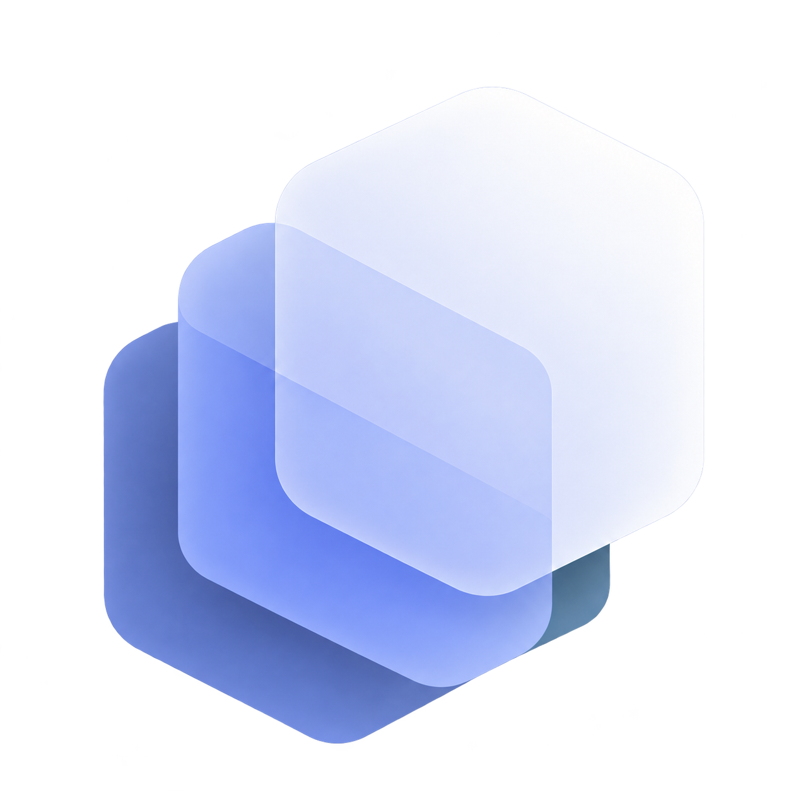
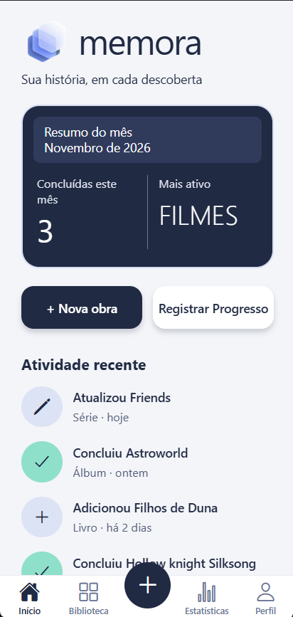
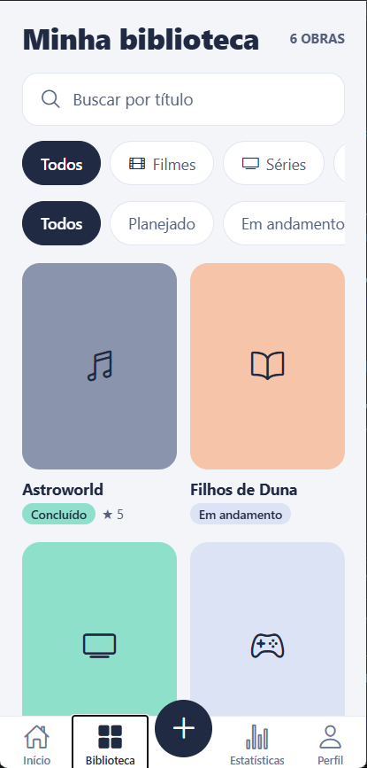
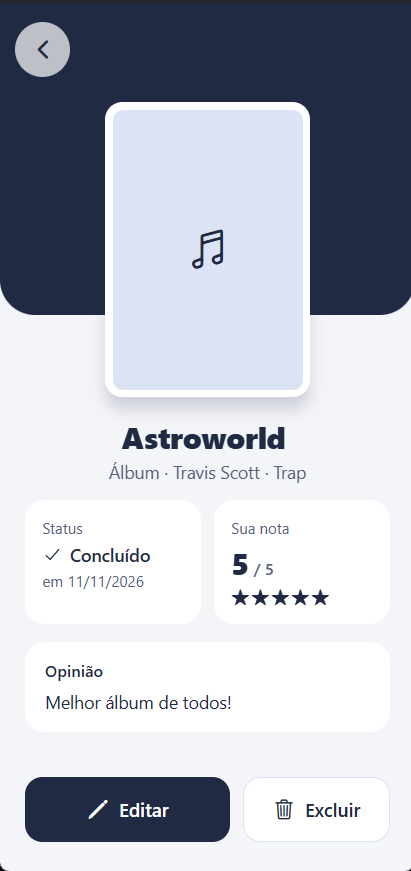

# Memora

**Sua história, em cada descoberta.**

<p align="left">
  
</p>

O **Memora** é um aplicativo mobile desenvolvido em React Native que centraliza o registro de experiências culturais e de entretenimento em uma única plataforma, A proposta é permitir que os usuários organizem filmes, séries, livros, jogos e álbuns musicais em uma biblioteca pessoal, registrando avaliações, opiniões, progresso e histórico de atividades.
Mais do que um catálogo, o Memora transforma os registros cotidianos em um arquivo pessoal de experiências culturais, permitindo acompanhar hábitos e revisitar descobertas ao longo do tempo.

> Projeto acadêmico desenvolvido para a disciplina de **CCP150 – Desenvolvimento de Aplicativos Móveis**, do curso de Ciência da Computação.

> **Projeto no Expo Snack:** [Abrir o Memora no Expo Snack](LINK_DO_SNACK)

---

## Sumário

- [1. Visão Geral e Requisitos](#1-visão-geral-e-requisitos)
- [2. Tecnologias Utilizadas](#2-tecnologias-utilizadas)
  - [2.1. Inteligência Artificial como Ferramenta de Apoio](#21-inteligência-artificial-como-ferramenta-de-apoio)
- [3. Protótipo de Design](#3-protótipo-de-design)
- [4. Funcionalidades](#4-funcionalidades)
  - [4.1. Autenticação de Usuários](#41-autenticação-de-usuários)
  - [4.2. Tela Início](#42-tela-início)
  - [4.3. Biblioteca Cultural](#43-biblioteca-cultural)
  - [4.4. Gerenciamento de Obras](#44-gerenciamento-de-obras)
  - [4.5. Imagens Personalizadas](#45-imagens-personalizadas)
  - [4.6. Progresso e Diário Cultural](#46-progresso-e-diário-cultural)
  - [4.7. Estatísticas](#47-estatísticas)
  - [4.8. Perfil do Usuário](#48-perfil-do-usuário)
  - [4.9. Feedback Háptico](#49-feedback-háptico)
- [5. Navegação e Estrutura do Aplicativo](#5-navegação-e-estrutura-do-aplicativo)
- [6. Demonstração](#6-demonstração)
- [7. Instalação e Execução](#7-instalação-e-execução)
- [8. Aprendizados e Próximos Passos](#8-aprendizados-e-próximos-passos)
- [9. Autor](#9-autor)

---

## 1. Visão Geral e Requisitos

### Motivação

Quem consome vários tipos de entretenimento costuma espalhar avaliações e registros por diferentes aplicativos, ou simplesmente esquece o que já assistiu, leu ou jogou e o que achou de cada experiência. O Memora nasceu da ideia de reunir tudo em um único lugar, com foco na experiência pessoal do usuário com cada obra, e não apenas em um catálogo de títulos.

### Objetivos

- Centralizar diferentes categorias de entretenimento em uma biblioteca pessoal.
- Permitir o acompanhamento do progresso de cada obra.
- Registrar avaliações e opiniões sobre experiências culturais.
- Organizar o histórico de atividades do usuário.
- Apresentar estatísticas baseadas nos registros realizados.
- Proporcionar uma experiência personalizada por meio de imagens e informações adicionadas pelo próprio usuário.

### Requisitos da disciplina

| Requisito | Como o Memora atende |
|---|---|
| Interface mobile com React Native | 7 telas funcionais, além de Login e Cadastro: Início, Biblioteca, Adicionar/Editar, Detalhes, Estatísticas, Diário e Perfil. |
| Navegação com React Navigation | Stack Navigation na raiz combinado com Bottom Tabs de cinco abas. |
| Persistência em banco de dados | Firebase Realtime Database, com as obras organizadas por usuário. |
| Operações CRUD | Criar, consultar, editar e excluir obras. |
| Autenticação de usuários | Firebase Authentication com e-mail e senha. |
| Recursos nativos do dispositivo | Câmera, galeria de imagens e feedback háptico. |
| Imagens e interface com feedback claro | Capas escolhidas pelo usuário, validações, alertas de confirmação, estados vazios e vibração. |

---

## 2. Tecnologias Utilizadas

| Categoria | Tecnologia | Aplicação |
|---|---|---|
| Linguagem | JavaScript | Linguagem de programação utilizada no projeto. |
| Framework | React Native | Desenvolvimento das interfaces mobile. |
| Backend | Firebase Authentication (v8.10.1) | Cadastro e autenticação de usuários. |
| Backend | Firebase Realtime Database (v8.10.1) | Armazenamento e sincronização dos dados. |
| Ferramentas | Expo Snack e Expo Go | Desenvolvimento e teste do aplicativo no celular. |
| Ferramentas | Figma | Protótipo e identidade visual. |
| Ferramentas | Git e GitHub | Controle de versão e hospedagem do código. |

### Armazenamento de dados e imagens

O projeto utiliza o Firebase Realtime Database para armazenar as informações das obras e os dados relacionados aos usuários.
As imagens personalizadas seguem uma estratégia diferente: são copiadas e armazenadas localmente no dispositivo, enquanto o banco de dados mantém apenas o nome do arquivo correspondente, Essa abordagem permite que o usuário utilize capas e imagens próprias sem depender de serviços externos de armazenamento de imagens.

### 2.1. Inteligência Artificial como Ferramenta de Apoio

A Inteligência Artificial foi utilizada como ferramenta complementar durante o desenvolvimento do Memora, auxiliando tanto na construção visual quanto na implementação de funcionalidades com maior complexidade técnica.

Sua utilização ocorreu principalmente nas seguintes atividades:

- **Desenvolvimento visual:** apoio na estruturação das interfaces, organização dos componentes, definição de layouts e aprimoramento da experiência do usuário.
- **Implementação de funcionalidades:** auxílio na elaboração e implementação de lógicas mais complexas, especialmente no sistema de seleção, manipulação e armazenamento local de imagens utilizando a câmera e a galeria do dispositivo.
- **Resolução de problemas:** suporte na identificação de erros, compreensão de bibliotecas e investigação de comportamentos inesperados durante o desenvolvimento.
- **Otimização do código:** sugestões de melhorias na organização, reutilização de componentes e estruturação das funcionalidades.

A Inteligência Artificial foi utilizada como recurso de apoio técnico e aprendizado, contribuindo para acelerar o desenvolvimento e facilitar a compreensão de conceitos e implementações. A integração, adaptação, validação e utilização das soluções no aplicativo fizeram parte do processo de desenvolvimento do projeto.

---

## 3. Protótipo de Design

Antes da implementação do aplicativo, foi desenvolvido um protótipo de interface no **Figma**, com o objetivo de estabelecer a identidade visual do Memora e orientar a construção das telas.
O protótipo serviu como referência para a organização dos elementos visuais, hierarquia das informações, navegação e experiência do usuário.

### Identidade visual

A proposta visual segue uma abordagem clara, minimalista e contemporânea, buscando equilibrar organização e personalidade.

Entre suas principais características estão:

- Fundos claros e espaços bem distribuídos.
- Azul profundo como cor principal da interface.
- Tons suaves de lavanda e verde-menta para superfícies e destaques.
- Cartões com cantos arredondados.
- Hierarquia tipográfica e componentes visuais consistentes.
- Capas das obras como elementos de destaque.

### Acesso ao protótipo

<ins>**[Acessar o protótipo do Memora no Figma](https://www.figma.com/design/bXRqMEJh4g7fACbINFMWgN/MEMORA?node-id=0-1&t=3sTla1ObIjCIuj3f-1)**</ins>

O protótipo pode ser utilizado como referência para compreender a concepção visual do aplicativo e as decisões de design tomadas durante o desenvolvimento.

---

## 4. Funcionalidades

### 4.1. Autenticação de Usuários

O aplicativo possui um sistema de autenticação integrado ao Firebase Authentication.

- Cadastro de novas contas utilizando e-mail e senha.
- Confirmação de senha durante o cadastro.
- Login de usuários registrados.
- Validação de credenciais e tratamento de erros, com mensagens claras (e-mail já cadastrado, senha fraca, e-mail inválido, entre outras).
- Encerramento de sessão por meio da opção de sair da conta, com confirmação.

Cada usuário possui sua própria biblioteca, com os registros associados ao seu identificador no Firebase.

### 4.2. Tela Início

A tela inicial reúne um resumo da atividade recente do usuário.

- Resumo do mês: quantidade de obras concluídas e categoria mais ativa.
- Atalho para cadastrar uma nova obra.
- Atalho "Registrar progresso", que lista as obras em andamento e abre a edição da obra escolhida.
- Atividade recente, com as últimas obras registradas ou atualizadas.
- Botão para cadastrar a primeira obra quando a biblioteca ainda está vazia.

### 4.3. Biblioteca Cultural

A biblioteca permite reunir diferentes categorias de entretenimento em um único ambiente.

As categorias disponíveis são:

| Categoria | Informações específicas |
|---|---|
| Filmes | Direção, gênero e avaliação. |
| Séries | Gênero, temporada, quantidade de episódios e avaliação. |
| Livros | Autor, gênero, páginas lidas, total de páginas e avaliação. |
| Jogos | Plataforma, horas jogadas e avaliação. |
| Álbuns | Artista, gênero e avaliação. |

A biblioteca também oferece:

- Visualização das obras cadastradas em formato de grade, das mais recentes para as mais antigas.
- Pesquisa pelo título das obras.
- Filtros por categoria.
- Filtros por status.
- Identificação visual do status e da avaliação de cada obra.
- Acesso aos detalhes da obra ao tocar em seu cartão.

### 4.4. Gerenciamento de Obras

O Memora permite gerenciar os registros pessoais por meio das operações CRUD.

- **Create:** adicionar novas obras à biblioteca.
- **Read:** consultar informações e detalhes das obras.
- **Update:** editar registros existentes.
- **Delete:** excluir obras da biblioteca, mediante confirmação.

Cada obra pode apresentar um dos seguintes status:

- Planejado.
- Em andamento (não se aplica a filmes).
- Concluído.
- Abandonado.

O formulário adapta os campos apresentados de acordo com a categoria selecionada, evitando informações desnecessárias. A mesma tela é utilizada para cadastrar e para editar uma obra.

Também é possível adicionar uma opinião pessoal e atribuir uma nota de 0 a 5. Ao concluir uma obra, a data de conclusão é registrada automaticamente.

O formulário valida os dados antes de salvar: o título é obrigatório e a nota deve estar entre 0 e 5.

### 4.5. Imagens Personalizadas

O aplicativo permite personalizar os registros utilizando imagens escolhidas pelo próprio usuário.

- Selecionar imagens diretamente da galeria.
- Tirar fotografias utilizando a câmera do dispositivo.
- Recortar a imagem em formato retrato (3:4).
- Visualizar uma prévia antes de salvar.
- Armazenar as imagens localmente no dispositivo.

As imagens são associadas aos respectivos registros por meio de seus nomes de arquivo. Quando uma obra não possui imagem, ou o arquivo não está disponível, o aplicativo exibe o ícone da categoria.

### 4.6. Progresso e Diário Cultural

O Memora permite acompanhar a evolução das experiências culturais e consultar um histórico organizado cronologicamente.

**Acompanhamento de progresso:**

- Livros: quantidade de páginas lidas e total de páginas.
- Séries: temporada e quantidade de episódios.
- Jogos: quantidade de horas jogadas.
- Filmes e álbuns: status e avaliações.

**Diário cultural:**

- Visualização das obras em uma linha do tempo.
- Organização dos registros por dia (hoje, ontem ou a data).
- Identificação de obras concluídas e atualizações.
- Exibição de informações de progresso.
- Consulta às opiniões registradas.

### 4.7. Estatísticas

A tela de estatísticas apresenta informações calculadas automaticamente a partir dos registros do usuário.

É possível alternar entre três períodos de análise:

- **Mês:** apresenta os dados do mês atual.
- **Ano:** apresenta os dados do ano atual.
- **Tudo:** considera o histórico completo.

Entre as informações disponíveis estão:

- Quantidade de obras concluídas.
- Média das avaliações.
- Categoria com maior atividade no período.
- Distribuição de obras por categoria.
- Gráfico de atividade por semana, mês ou ano, conforme o período selecionado.

### 4.8. Perfil do Usuário

A tela de perfil apresenta um resumo da jornada cultural do usuário.

- Identificação baseada no e-mail cadastrado.
- Data de criação da conta.
- Quantidade total de obras na biblioteca.
- Quantidade de obras concluídas.
- Média geral das avaliações.
- Distribuição de registros por categoria.
- Acesso direto ao diário cultural.
- Opção de encerrar a sessão.

### 4.9. Feedback Háptico

O aplicativo utiliza a biblioteca Expo Haptics para oferecer respostas táteis durante interações importantes, com o objetivo de proporcionar uma resposta física discreta que complemente o feedback visual da interface.

O feedback háptico é acionado em três situações:

- Após salvar uma obra.
- Após excluir uma obra.
- Após sair da conta.

---

## 5. Navegação e Estrutura do Aplicativo

A navegação foi desenvolvida utilizando React Navigation, combinando Stack Navigation e Bottom Tab Navigation. As telas de login, cadastro, adicionar/editar, detalhes e diário ficam no Stack e abrem por cima das abas.

### Navegação principal

A navegação por abas disponibiliza cinco opções:

| Tela | Responsabilidade |
|---|---|
| Início | Resumo mensal, atividades recentes e atalhos. |
| Biblioteca | Consulta, pesquisa e filtragem das obras. |
| Adicionar | Cadastro de novas obras. |
| Estatísticas | Visualização de indicadores e gráficos. |
| Perfil | Informações da conta e resumo da jornada cultural. |

### Telas complementares

Além das telas principais, o aplicativo possui:

- Login.
- Cadastro.
- Adicionar e editar conteúdo.
- Detalhes da obra.
- Diário cultural.

### Modelo de dados

Cada usuário possui sua própria árvore no Firebase Realtime Database, identificada pelo seu `uid`. Cada obra é um nó com identificador gerado pelo Firebase:

```text
/usuarios
  /{uid do usuário}
    /obras
      /{id da obra}
        titulo, categoria, status, nota, opiniao
        imageName, criadaEm, atualizadaEm, concluidaEm
        + campos da categoria (direcao, autor, paginasLidas, horas...)
```

A configuração de cada categoria (campos do formulário, ícone, cor e status permitidos) fica centralizada em `components/Obras.js`, e as telas se adaptam a ela.

### Organização dos arquivos

```text
MEMORA/
│
├── App.js
├── index.js
├── app.json
├── package.json
│
├── assets/
│   └── Logo.png
│
├── components/
│   ├── Auth.js
│   ├── Cores.js
│   ├── Formulario.js
│   ├── Haptico.js
│   ├── Imagens.js
│   └── Obras.js
│
├── config/
│   └── config.js
│
├── screenshots/
│
└── screens/
    ├── AdicionarConteudo.js
    ├── Biblioteca.js
    ├── Cadastro.js
    ├── DetalhesObra.js
    ├── Diario.js
    ├── Estatisticas.js
    ├── HomeScreen.js
    ├── Login.js
    └── Perfil.js
```

A estrutura separa as telas, componentes reutilizáveis, configurações e funções compartilhadas, facilitando a manutenção e a organização do código.

---

## 6. Demonstração

### Vídeo

**[Assistir à demonstração do Memora](https://youtube.com/shorts/NVnXMFQTy98)**

O vídeo apresenta o aplicativo em funcionamento, com os principais fluxos de utilização:

1. Cadastro e autenticação de usuário.
2. Adição de uma nova obra com imagem personalizada.
3. Pesquisa e filtragem na biblioteca.
4. Edição e consulta dos detalhes de uma obra.
5. Atualização de status e progresso.
6. Consulta ao diário cultural e às estatísticas.
7. Visualização do perfil e encerramento da sessão.

### Algumas telas do aplicativo

<table>
  <tr>
    <td align="center"><br><b>Início</b></td>
    <td align="center"><br><b>Biblioteca</b></td>
    <td align="center"><br><b>Adicionar conteúdo</b></td>
  </tr>
  <tr>
    <td align="center"><br><b>Detalhes da obra</b></td>
    <td align="center"><br><b>Estatísticas</b></td>
  </tr>
</table>

---

## 7. Instalação e Execução

O Memora foi desenvolvido no **Expo Snack** e testado no **Expo Go**, em um celular. Há duas formas de executá-lo.

### Pré-requisitos

- Um celular com o aplicativo **Expo Go** instalado (em uma versão compatível com o Expo SDK 54).
- Uma conta no Firebase com um projeto próprio (passo a passo abaixo).
- Para a execução local: **Node.js** (versão LTS) e **npm**.

### Passo 1 — Preparar o Firebase

1. No [console do Firebase](https://console.firebase.google.com/), crie um projeto.
2. Em **Authentication**, ative o método de login **E-mail/senha**.
3. Em **Realtime Database**, crie um banco de dados.
4. Nas configurações do projeto, registre um app Web e copie o objeto de configuração.

### Passo 2 — Configurar as credenciais

No arquivo `config/config.js`, preencha o objeto `firebaseConfig` com as credenciais do seu projeto.
O repositório não inclui credenciais. Não publique as suas em repositórios públicos.

### Opção A — Executar localmente

```bash
git clone https://github.com/Gabriel-p-coelho/MEMORA.git
cd MEMORA
npm install
npx expo start
```

Depois de configurar o Firebase (passos 1 e 2), escaneie o QR Code exibido no terminal com o Expo Go.

### Opção B — Executar no Expo Snack

O projeto completo está disponível no Expo Snack: **[Abrir o Memora no Expo Snack](LINK_DO_SNACK)**

Para criar o seu próprio Snack a partir do repositório:

1. Acesse [snack.expo.dev](https://snack.expo.dev/) e crie um novo Snack com o **SDK 54**.
2. Crie os arquivos e as pastas do projeto (`App.js`, `components/`, `config/`, `screens/` e `assets/Logo.png`) com o conteúdo deste repositório.
3. Em **Dependencies**, adicione `firebase@8.10.1`. As demais bibliotecas são sugeridas pelo próprio Snack ao detectar os `import`.
4. Preencha `config/config.js` (passo 2).
5. Abra o projeto no celular pelo Expo Go (**My Device**, com o QR Code).

### Observações importantes

- **Firebase na versão 8.10.1:** o código usa a sintaxe `import firebase from "firebase"`, que só funciona nessa versão. Versões 9 ou superiores exigem outra sintaxe.
- **Imagens:** o código importa `expo-file-system/legacy` de propósito, pois é a API que foi validada no Expo Go com o SDK 54.
- **Permissões:** na primeira vez que usar a câmera, o aplicativo solicitará a permissão de acesso.

---

## 8. Aprendizados e Próximos Passos

O desenvolvimento do Memora proporcionou a aplicação prática de conceitos de desenvolvimento mobile, integração com serviços externos e organização de aplicações.

### Reflexão sobre a experiência

O principal desafio de modelagem foi lidar com cinco categorias diferentes de obras dentro de um único fluxo. Em vez de criar um formulário para cada categoria, concentrei a configuração delas em um único arquivo (`Obras.js`) e deixei que as telas se adaptassem a essa configuração. Isso reduziu repetição de código e deixou o aplicativo mais fácil de evoluir.

Também aprendi a lidar com limitações do ambiente de desenvolvimento. No Expo Snack, foi necessário usar a API legada do Expo File System, depois de testar alternativas que não funcionaram. A decisão de guardar as imagens no próprio dispositivo, e não na nuvem, foi uma escolha consciente por simplicidade: o banco guarda apenas o nome do arquivo, ao custo de a imagem não acompanhar o usuário em outro aparelho.

Na etapa final, revisei o código inteiro: unifiquei as cores em um único arquivo e removi trechos sem uso. 
Essa revisão me mostrou que organizar e simplificar o código é tão importante quanto fazê-lo funcionar.

### Aprendizados

- Desenvolvimento de interfaces utilizando React Native e Expo.
- Implementação de navegação com React Navigation.
- Estruturação e reutilização de componentes.
- Integração com Firebase Authentication.
- Persistência e sincronização de dados com Firebase Realtime Database.
- Implementação de operações CRUD.
- Manipulação de imagens utilizando câmera e galeria.
- Armazenamento local de arquivos no dispositivo.
- Integração com recursos nativos por meio de feedback háptico.
- Construção de estatísticas a partir de dados persistidos.

### Limitações atuais

- As imagens ficam apenas no dispositivo em que foram escolhidas e não são sincronizadas entre aparelhos.
- O aplicativo sempre abre na tela de login, mesmo que a sessão ainda esteja ativa.
- Não há filtro por gênero na biblioteca, apesar de o gênero ser registrado em cada obra.

### Próximos Passos

Como possíveis evoluções futuras, o projeto poderá receber:

- Sincronização e armazenamento de imagens na nuvem, com o Firebase Storage.
- Sistema de metas culturais e acompanhamento de objetivos.
- Retrospectivas mensais e comparação entre períodos.
- Filtro por gênero e histórico de sessões de progresso.
- Integração com APIs externas para pesquisa automática de obras.
- Manutenção do login entre aberturas do aplicativo.
- Melhorias na experiência do usuário e nos recursos de personalização.

---

## 9. Autor

**Gabriel Pacioni Coelho**
Estudante de Ciência da Computação.
- [GitHub](https://github.com/Gabriel-p-coelho)
- [LinkedIn](https://www.linkedin.com/in/gabriel-pacioni-coelho/)